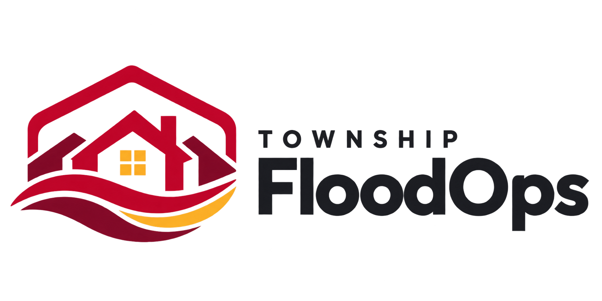
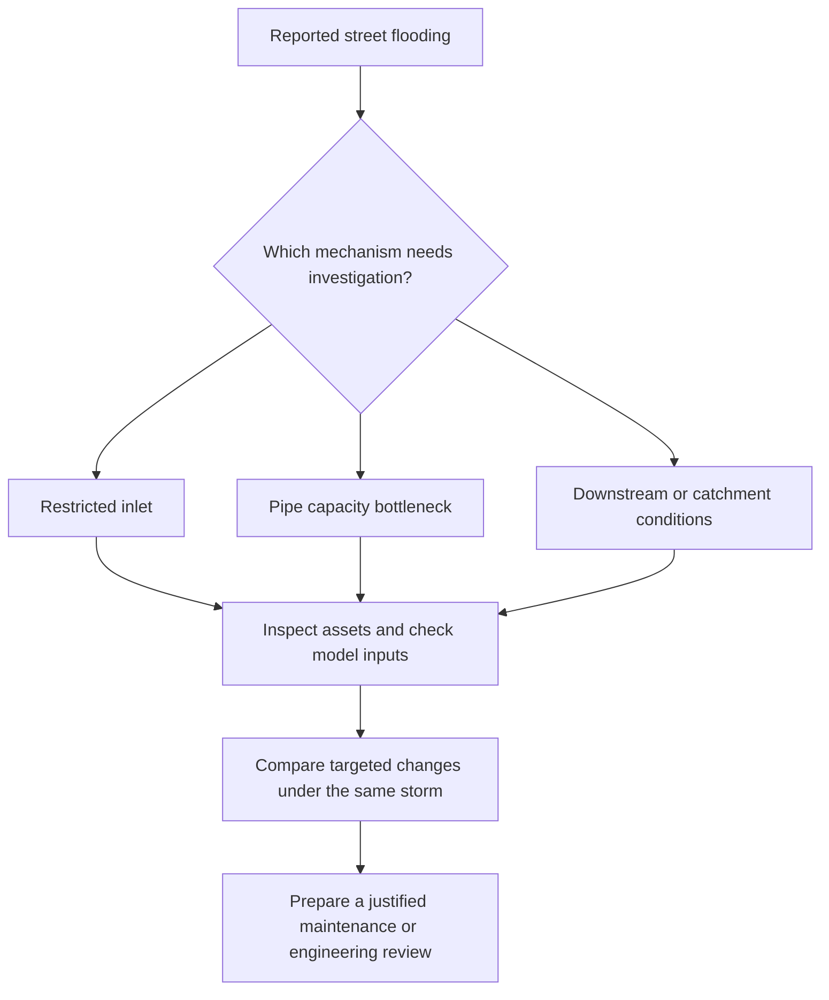

<div align="center">

<picture>
  <source media="(prefers-color-scheme: dark)" srcset="docs/brand/floodops-logo-dark.png" />
  
</picture>

# Township FloodOps

### Understand the flood. Test the options. Plan the next action.

Evidence-backed drainage maintenance planning for township operations.

**React 19 · TypeScript · Three.js · Browser flood engine · Optional FastAPI + EPA SWMM**

[Get started](#getting-started) · [Try the sample](#try-the-sample-township) · [How it works](#how-floodops-works) · [Impact](#impact) · [Documentation](#documentation)

</div>

---

## Start here

FloodOps brings site files, a 3D drainage map, flood calculations and investigation records into one workspace. Upload a township's drainage model, review missing inputs, compare a pipe option and retain the evidence behind the next decision.

The main app runs **entirely in your browser**. Projects, runs, inspections, attachments and draft proposals are stored locally in IndexedDB. No backend or sign-in is required for this route.

**New to the project?** [Start the app](#getting-started), then [load the synthetic Taman Kyra sample](#try-the-sample-township). For the earlier D07 maintenance story, choose **Open illustrative demo** on the portal and follow the [operator walkthrough](md/EXACT_DEMO_WALKTHROUGH.md) or [three-minute pitch runbook](md/DEMO_RUNBOOK.md).

> **Pilot scope:** Imported models remain uncalibrated until checked against the real site. The sample township is synthetic. Calculated results support investigation; they do not establish validated street flood depths, construction approval or measured savings.

## The problem

**A flooded street is visible. The right intervention still needs evidence.** Township operations teams need to establish which asset is involved, what condition was observed and whether a proposed change improves the modelled outcome under the same storm.

### The cost is measurable

Malaysia's Department of Statistics reports the following flood damage losses:

| Damage category | 2024 | 2025 |
| --- | ---: | ---: |
| **Total reported losses** | **RM933.4 million** | **RM636.9 million** |
| **Public assets and infrastructure** | **RM303.4 million** | **RM380.2 million** |
| **Living quarters** | **RM372.2 million** | **RM183.8 million** |

Even as total losses fell, public asset and infrastructure losses **increased by 25.3%** (calculated from the reported figures). Source: [DOSM, *Special Report on Impact of Floods in Malaysia, 2025*, released 15 April 2026](https://www.dosm.gov.my/site/downloadrelease?id=special-report-on-impact-of-floods-in-malaysia2025&lang=English).

These are national losses across flood types, not losses attributed solely to blocked drains or an estimate of what FloodOps could prevent.

### The same symptom can have different causes

DID identifies intense rainfall, increased impervious area, sediment and channel obstruction among flood drivers. Its stormwater inlet guidance calls for regular checks and cleaning to prevent debris blockage, while also explaining that insufficient downstream capacity can prevent an inlet from functioning properly. Together, these establish why both maintenance condition and hydraulic context matter. Sources: [DID flood management guidance](https://www.water.gov.my/index.php/pages/view/419), [Urban Stormwater Management Manual, chapter 24, §§24.1 and 24.7](https://www.water.gov.my/jps/resources/auto%20download%20images/58464dc10bb4f.pdf).



*Conceptual investigation paths, not an automatic diagnosis or a complete list of flood causes.*

**The decision gap FloodOps targets:** connecting a report to the relevant asset, inspection evidence, explicit assumptions, matching comparisons and a retained follow-up draft. The national statistics establish the stakes; site evidence and calibrated modelling are still needed to justify a local intervention. See the [evidence and comparison notes](docs/PROBLEM_EVIDENCE.md).

## How FloodOps works


| Stage | What you can do |
| --- | --- |
| **Diagnose** | Inspect supplied geometry, locate drainage assets and record problems, reports, inspections and missing evidence. |
| **Anticipate** | Run the browser flood engine, inspect network and street-water outputs, and compare a circular pipe diameter change with the same baseline inputs. |
| **Act** | Retain comparison evidence, prepare investigation drafts, assign follow-up and export records for review. |

The separate illustrative demo adds the guided D07 story, conceptual cleaning and storage scenarios, road-area measurements and calculation reference checks. Its **Engine**, **Mock** and **SWMM API** modes are explicitly identified.

## What makes FloodOps useful

- **Start with your site.** The portal opens without a preloaded township. Map geometry comes from the files you supply, with unsupported or missing inputs listed for review.
- **Check readiness before running.** A usable map and a runnable hydraulic model have separate readiness checks.
- **Compare matching inputs.** A pipe option changes the selected diameter while retaining rainfall and other baseline inputs. Source hashes and run snapshots keep the comparison traceable.
- **Keep observations and assumptions separate.** Visible grate coverage from an inspection is distinct from an assumed hydraulic inlet restriction.
- **Carry evidence into operations.** Project problems, inspection attachments, draft proposals and follow-up records stay connected to the investigation.
- **Show failures clearly.** Calculation and API errors are displayed. Failed real runs never silently become mock results.

### What makes us unique

**FloodOps brings the township investigation into one browser workspace:** report → asset → evidence → comparable calculation → follow-up draft. Its distinguishing focus is the connection between these steps, with missing inputs, source files and modelling assumptions visible throughout.

| Existing solution | What it already does well | Our approach in FloodOps |
| --- | --- | --- |
| [**Public InfoBanjir — DID Malaysia**](https://publicinfobanjir.water.gov.my/main/?lang=en) | Publishes rainfall, water-level information and flood warnings for public awareness. | Focus on an individual township's drainage assets, inspection evidence and intervention investigation. FloodOps currently uses supplied or synthetic inputs; it has no live warning feed. |
| [**EPA SWMM**](https://www.epa.gov/water-research/storm-water-management-model-swmm) | Provides rainfall-runoff and drainage-network modelling, scenario analysis, maps, plots and reports. It is free and open source. | Pair a 3D operations workspace with readiness checks, evidence records and draft follow-up. The default portal uses our browser engine; native SWMM is a separate optional route. |
| [**Autodesk InfoWorks ICM**](https://help.autodesk.com/cloudhelp/2025/ENU/ICM-Help/files/GUID-8BC95C3D-3957-4C59-8024-2DB91228CBF2.htm) | Supports integrated catchment modelling, scenario comparison, 2D/3D views, shared model data and audit trails. | Offer a narrower browser-local pilot for the township report-to-investigation workflow. FloodOps does not establish equivalent modelling accuracy, enterprise collaboration or engineering approval capability. |

The pilot combines **separate map/model readiness**, **inspection observations kept distinct from hydraulic assumptions**, and **source-linked comparison drafts**. Existing engineering platforms already support advanced simulation and scenario management; our contribution is the specific operations workflow demonstrated here.

#### A concrete demonstration: cleaning is not always the effective modelled change

The recorded **synthetic D07 browser demo** uses 80 mm/h rain for 60 minutes, 40% assumed inlet loss and Normal canal conditions. Independent candidate runs retain the other baseline inputs:

| Modelled option | Peak depth at fixed road point R1 | Maximum simultaneous selected road area ≥15 cm |
| --- | ---: | ---: |
| Baseline | 60.0 cm | 760 m² |
| Clean D07 | 59.8 cm | 760 m² |
| Enlarge P07 from 600 to 750 mm, retaining original inlet loss | 7.7 cm | 0 m² |

This example shows why a plausible cleaning action should be tested alongside a capacity hypothesis. These are rounded outputs from a synthetic model, not observed site improvements or a general recommendation to enlarge pipes. [Recorded calculation basis, study area, reproduction command and limits](md/CALCULATION_FOUNDATION.md).

## Impact

**Plan the right drainage works. Make better use of maintenance budgets and staff time.** FloodOps brings drainage complaints, inspection records and simulation results together, helping township teams decide which works to prioritise and explain why they are needed.

> **87.2% lower peak water depth at the selected road point in our demo model.**
>
> **Pilot target: 75% less time spent preparing an investigation.**
>
> **Potential time freed up: 600 staff-hours per township each year, based on the assumptions below.**

### Before and after: results from our demo model

In our **synthetic D07 demo**, we compared the existing 600 mm P07 pipe with a proposed 750 mm pipe. Both simulations used the same **80 mm/h, 60-minute storm**, **40% assumed inlet loss** and **Normal canal** conditions.

| What we measured | Before: existing pipe | After: proposed larger P07 pipe | Change in the simulation |
| --- | ---: | ---: | --- |
| **Peak water depth at road point R1** | 60.0 cm | 7.7 cm | **87.2% lower** |
| **Largest selected road area with water ≥15 cm at any one time** | 760 m² | 0 m² | **760 m² less above the reference depth** |
| **Approximate time water at R1 stays ≥15 cm** | 75 min | 0 min | **75 minutes less above the reference depth** |

Cleaning D07 alone still left **760 m²** above the same reference depth. Comparing the options helps the team assess whether cleaning is sufficient or a pipe upgrade should be referred for engineering review. These results come from an uncalibrated synthetic model. The 15 cm reference is used to compare results; it does not indicate whether a road is safe, and shallower water may still be present. [Results, measurement details and how to repeat the demo](md/CALCULATION_FOUNDATION.md).

### Before and after: expected benefits for township operations

**These are proposed pilot targets based on assumptions. Actual results still need to be measured.** For this example, we assume **100 investigations per township per year**, with **8 staff-hours per case** for the current process and a FloodOps target of **2 staff-hours per case**. This covers compiling records, comparing options and preparing a proposal for review. Site visits, engineering approval and construction are excluded.

| What we aim to improve | Before: assumed current process | After: FloodOps pilot target | Benefit if the target is met |
| --- | ---: | ---: | --- |
| **Staff time to prepare each investigation** | 8 staff-hours | 2 staff-hours | **75% less staff time** |
| **Yearly preparation time · 100 cases** | 800 staff-hours | 200 staff-hours | **600 staff-hours freed up** |
| **Value of yearly preparation time · assumed RM50/hour** | RM40,000 | RM10,000 | **RM30,000 worth of staff time freed up** |

If the same target is achieved across **10 townships**, this would free up **6,000 staff-hours a year**, worth **RM300,000 at the assumed rate**. This example shows the potential at a larger scale; it does not represent confirmed users or adoption. The value refers to staff time available for other work, rather than money saved in the budget. Setup, training, survey and engineering costs are excluded. The pilot will need to measure current working hours and check whether the target is achievable.

### What this means for township teams and residents

| Who benefits | Expected benefit | How FloodOps helps |
| --- | --- | --- |
| **Maintenance and operations teams** | Clearer priorities for inspections and drainage works. | Locate reported problems, check inspection records and use automated suggestions to shortlist possible solutions. |
| **Drainage engineers** | Better information when assessing cleaning works and pipe upgrades. | Compare options using the same rainfall and starting conditions, with assumptions and before-and-after results kept for reference. |
| **Township managers and developers** | Stronger justification for maintenance spending and proposed upgrades. | Prepare a proposal with source files, comparison results, indicative costs and follow-up details for review. |
| **Residents** | Better-informed action on recurring drainage complaints and clearer follow-up. | Link each report to the relevant drain, investigation history and person responsible for follow-up in the operations workspace. |

### How we will check the impact on site

A pilot should compare similar cases handled with and without FloodOps at a site with surveyed data and engineering review. Record staff time and the quality of each proposal, including any corrections needed, to check the **8 → 2 staff-hour target**. Separately, track the total time from receiving a complaint to completing the review, repeat complaints and actual maintenance costs. Compare the model with recorded storm conditions, then assess conditions after the works while accounting for rainfall and downstream water levels. [Assumptions and calculations behind the impact figures](docs/PROBLEM_EVIDENCE.md).

## Architecture at a glance


*The default portal runs locally in the browser. The lower row is a separate, explicitly selected native API route. [Diagram source](docs/diagrams/README.md).*

The **rule-based AI decision support** uses programmed diagnosis and candidate-generation rules, then tests fixes with the browser flood engine. It considers up to 3 detected problems and 8 candidates (pipe upsizing, relief pipes or an extra inlet), ranks improving options and displays suggested fixes on map pins. It uses no machine learning or LLM; recommendations are uncalibrated and require engineering review.

| Component | Implementation |
| --- | --- |
| **Main workspace** | React 19, TypeScript, Vite, Three.js / React Three Fiber, Drei and Tailwind CSS. |
| **Browser calculations** | `packages/engine`: 2D surface flow coupled to a capacity-routed pipe network, with water-balance checks. |
| **Automated solution suggestions** | `packages/engine/src/analysis/fixFinder.ts`: rule-based diagnosis, candidate generation and ranking; browser workers simulate candidates before recommendations appear. |
| **Local persistence** | IndexedDB for imported projects, retained runs, inspections/media and draft proposals; problem records remain browser-local. |
| **Optional native calculations** | FastAPI and the SWMM toolkit, with Python simulation code under `simulation/` and retained runtime artifacts. |
| **Interface contracts** | OpenAPI and examples under `contracts/`, with explicit source labels, assumptions and error responses. |

The browser model and native SWMM model have different numerical scope. Passing a reference or conservation check does not establish real-site accuracy. The [calculation foundation](md/CALCULATION_FOUNDATION.md) explains the metrics, checked examples and remaining limits.

## Documentation

All guides below are written in English.

| Guide | What it covers |
| --- | --- |
| [Problem evidence and comparison notes](docs/PROBLEM_EVIDENCE.md) | Official flood-loss statistics, maintenance rationale, existing solutions and the limits of the product claims. |
| [Frontend setup](md/FRONTEND_SETUP.md) | Web development, modes and frontend configuration. |
| [Backend setup](md/BACKEND_SETUP.md) | Optional FastAPI service, native SWMM installation and backend checks. |
| [Site file specification](apps/web/public/site-examples/README.md) | Supported uploads, sample files, import rules and metric definitions. |
| [Calculation foundation](md/CALCULATION_FOUNDATION.md) | Road measurements, matched-input checks, native actions and validation limits. |
| [Exact operator walkthrough](md/EXACT_DEMO_WALKTHROUGH.md) | The guided illustrative maintenance story, evidence and proposal handoff. |
| [Three-minute pitch runbook](md/DEMO_RUNBOOK.md) | Presentation flow and demo actions. |
| [API contracts](contracts/README.md) | Machine-readable interfaces and integration examples. |
| [Maintenance integration](contracts/MAINTENANCE_INTEGRATION.md) | Evidence-linked proposals and lifecycle rules. |
| [Legacy API upload walkthrough](md/UPLOAD_FIRST_WALKTHROUGH.md) | The earlier server-backed site import route. |
| [Team workflow](md/TEAM_WORKFLOW.md) | Responsibilities, file ownership and handoff rules. |

## Repository layout

```text
apps/web/           Main upload-first workspace and illustrative demo
apps/legacy/        Original engine UI, retained for reference
packages/engine/    TypeScript browser flood engine
services/api/       Optional FastAPI backend
simulation/         Native SWMM and scenario calculation code
contracts/          OpenAPI, examples and integration guides
data/               Synthetic inputs, samples and retained validation evidence
models/             Model assets and supporting files
tests/              API, simulation and end-to-end checks
md/                 Product background, setup, demos and team progress
docs/               Engine notes, design records and README brand assets
```
## Getting started

### Requirements

- **Node.js 20+** and **npm 10+**.
- A modern browser with WebGL support for the 3D workspace.
- Python and the native SWMM toolkit only if you want the optional API route.

### Run the main app

From the repository root:

```bash
npm install
npm run dev:web
```

Open [http://localhost:5173](http://localhost:5173). The site portal checks, builds and simulates your project in the browser.

### Try the sample township

Use the sample downloads on the portal, or select these files from [`apps/web/public/site-examples/taman-kyra-swmm/`](apps/web/public/site-examples/taman-kyra-swmm/):

| Upload slot | Sample file | Purpose |
| --- | --- | --- |
| **SWMM model** — required | `taman_kyra.inp` | Drainage network, coordinates, subcatchments and rainfall. |
| **Layout** — optional | `taman_kyra_layout.geojson` | Buildings, roads and inlets in the same projected metric reference. |
| **Height grid** — optional | `taman_kyra_ground.asc` | Ground elevations for the terrain and street-water model. |

1. Select the three files, then choose **Check my files**.
2. Review the supplied geometry and readiness notes. The sample includes **9 nodes, 8 pipes, 4 catchments and 35 buildings**.
3. Choose **Build my township** to open the 3D workspace.
4. Open **Compare actions**, calculate the baseline, then test **PIPE-P07 at 0.75 m**.
5. Use **Operations** to record a problem and prepare its investigation follow-up. Reload the app to reopen the project under **Your saved projects**.

All inputs must share one projected coordinate system in **metres**. Each file may be up to **8 MiB**. Buildings require `height_m`; roads require `width_m`. CAD, PDF and GeoTIFF extraction are not implemented. See the [complete file specification and sample notes](apps/web/public/site-examples/README.md).

### Optional: native SWMM API

The Python API is a separate route for native EPA SWMM network calculations and the earlier API workflows. Importing a `.inp` in the main portal runs the **FloodOps browser engine**, rather than invoking native SWMM.

Follow the [backend setup guide](md/BACKEND_SETUP.md) to install and start FastAPI on port **8000**. In the illustrative demo, select **Settings → Live FastAPI**. The API retains its own records and native run artifacts; it is not required by the default portal.
