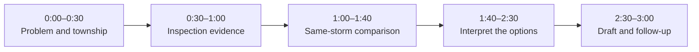

# Township FloodOps — Three-Minute Demo Runbook

> **Tagline:** From flood hindsight to flood readiness.
>
> **Setting:** The synthetic Taman Kyra / D07 demonstration, not a surveyed reconstruction of a real flood.
>
> **Main demo source:** The FloodOps TypeScript browser engine. Native EPA SWMM is a separate optional API route.

## Prepare before presenting

1. From the repository root, run `npm install` if dependencies are missing, then `npm run dev:web`.
2. Open `http://localhost:5173`. The default page is the upload-first site portal. Choose **Open illustrative demo** for this D07 story.
3. In **Settings**, select **Engine**. Keep the three-minute presentation in this mode.
4. Rehearse the [exact operator walkthrough](EXACT_DEMO_WALKTHROUGH.md), including the synthetic problem, D07 inspection, three calculations, draft proposal and follow-up.
5. Prepare the D07 comparison using **80 mm/h for 60 minutes**, **40% assumed inlet loss**, **Normal** canal conditions, **D07 street junction** and the **15 cm** measurement reference. Run the baseline, cleaning and P07 candidates during rehearsal. Browser calculations previously took about 17–19 seconds each on the documented machine; allow for your hardware.
6. Have the prepared results ready before the timed pitch. If you show retained results, call them retained results. If you run live, show progress and wait for actual completion.

This runbook replaces the earlier script that referred to removed field feeds and animated inspectors, treated fixture playback as the default native calculation, and used superseded comparison values. Do not present those earlier instructions as current behaviour.

## Storyline and timing

## Scene 1: the problem and the township (0:00–0:30)

### Speaker script

> “A flooded street is visible, but the correct next action still needs evidence. Should the team inspect and clean an inlet, investigate pipe capacity, or check downstream conditions? FloodOps connects the report to the asset, the assumptions and the comparison behind that decision.”

### Screen actions

1. Show the synthetic D07 problem in **Dashboard** and its missing-evidence or follow-up fields.
2. Open the map or the guided browser story and locate **INLET-D07**.
3. Show the 3D drainage context. Explain that the geometry is illustrative, rather than a surveyed site model.

## Scene 2: inspection evidence and assumptions (0:30–1:00)

### Speaker script

> “The inspection record preserves what someone saw and where it came from. Visible grate coverage is an observation. Hydraulic inlet loss is a separate modelling assumption; we do not automatically convert a photograph into a calibrated hydraulic parameter.”

### Screen actions

1. Open the prepared D07 inspection and its synthetic attachment.
2. Show its source label, time and notes.
3. Point out the independent **40% assumed inlet loss** used in the comparison.

Use the exact input fields and synthetic files in the [operator walkthrough](EXACT_DEMO_WALKTHROUGH.md). Do not label demo PDFs as real field photographs or observed evidence.

## Scene 3: test the same storm (1:00–1:40)

### Speaker script

> “The browser engine calculates a baseline, then changes one intervention while retaining the other inputs. We compare the same storm and the same measurement area, so the displayed difference has an explicit basis.”

### Screen actions

1. Show the prepared baseline from **Test this storm**.
2. Show the independent **Try cleaning D07** and **Test P07: 600 → 750 mm** candidates.
3. Keep **D07 street junction** and the **15 cm** reference selected. Show the fixed R1 point and selected road cells.
4. If calculating live, wait for completion and retain any displayed errors. Do not replace failed output with fixture values.

## Scene 4: interpret the options (1:40–2:30)

### Speaker script

> “In this synthetic example, cleaning alone barely changes the selected road result, while the pipe option changes it substantially. That is a reason to request a capacity investigation, not permission to construct a larger pipe. The result depends on the supplied model, storm and boundary assumptions.”

### Screen actions

Show the actual retained comparison. The previously documented rounded outputs are:

| Option | Peak at fixed road point R1 | Maximum simultaneous selected road area ≥15 cm | Approximate R1 duration ≥15 cm |
|---|---:|---:|---:|
| Baseline | 60.0 cm | 760 m² | 75.0 min |
| Clean D07 | 59.8 cm | 760 m² | 74.0 min |
| P07: 600 → 750 mm, original inlet loss retained | 7.7 cm | 0 m² | 0.0 min |

Use the values actually returned for your run. See the [calculation foundation](CALCULATION_FOUNDATION.md) for the exact road mask, assumptions, reproduction command and limitations. These are synthetic numerical outputs, not measured site benefits.

If time permits, show the calculation reference checks and their **site/street-depth validation not established** qualification. Native SWMM reference checks require the optional API; they are separate calculations and do not validate the browser surface model.

## Scene 5: retain the decision and follow up (2:30–3:00)

### Speaker script

> “The output is an evidence-linked next step. We retain the comparison, record what is still unknown and assign an owner to the investigation. The saved draft requests engineering review; it does not dispatch work, approve spending or claim measured savings.”

### Screen actions

1. Choose **Choose the next action → Request engineering review → Prepare a work proposal**.
2. Show **PIPE-P07**, **Current comparison attached**, the review scope and the unresolved survey/downstream constraints.
3. Show the prepared **Draft**. Unknown rates remain blank, with **Estimate required**.
4. Show the evidence JSON export and the Operations case assigned to the township engineering team with an investigation due date.

For a three-minute pitch, prepare these records in rehearsal and show them honestly as prepared records. The [full walkthrough](EXACT_DEMO_WALKTHROUGH.md) explains the manual problem/inspection cross-reference and the complete save/export sequence.

## Presenter recovery notes

| Situation | Response |
|---|---|
| Browser calculation takes longer than expected | Show progress and explain the inputs; use previously retained results only if clearly identified. |
| API is unavailable | Keep the main pitch in the explicit browser Engine mode. Explain that native reference checks are unavailable; never claim a native result was computed. |
| A run fails | Show the error and correct its cause before rerunning. Do not claim completion or silently switch to Mock. |
| Camera view is lost | Use an available overview or asset view preset to return to the selected township area. |
| A prepared record is missing | Rehearse the exact walkthrough in advance. Browser records are local and source modes use separate collections. |
| Someone asks whether this proves real flood reduction | State that field survey, calibration, engineering review and post-work measurements are still required. |

## Documentation update — 22 October 2026

Published this English runbook with current portal entry, browser-engine terminology, retained D07 comparison values and draft-only follow-up. Application code and the recorded calculation evidence were not changed or rerun.
