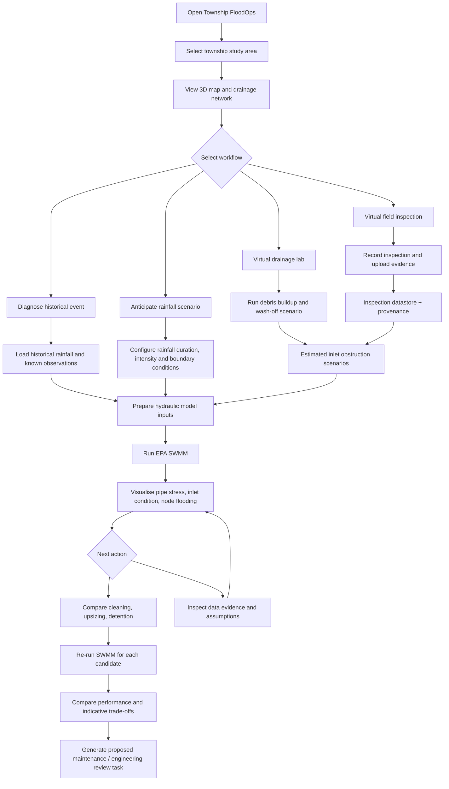
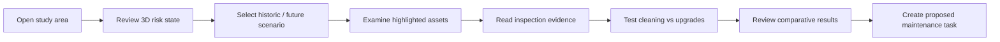
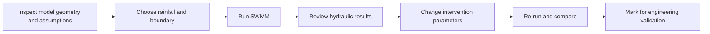
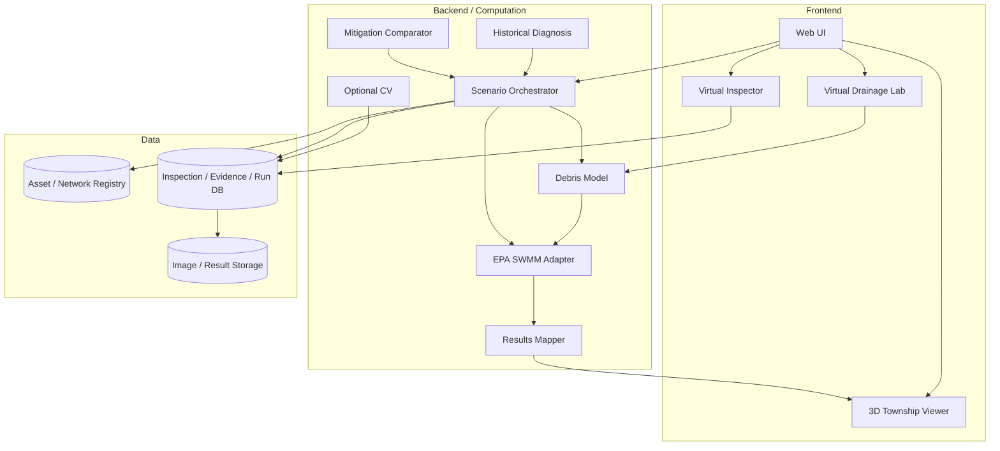

# Township FloodOps — Feature Flow, User Flow & Module Breakdown

> **Product:** Inspection-Informed Flood Resilience Platform  
> **Case-study context:** Taman Kyra, Bandar Bukit Raja, Klang (documented flooding concerns)  
> **Prototype scope:** One **illustrative** residential drainage subcatchment, not an authenticated map of the property's underground infrastructure.  
> **Primary user:** Township operations / maintenance manager  
> **Secondary users:** Field inspector, drainage engineer, planning manager  
> **Status:** Hackathon MVP product specification — not an engineering-certified flood prediction system.

---

## 1. Product goal and core user story

**Goal:** Help township operators investigate why a neighbourhood might flood, assess its response to selected future rainfall scenarios, and compare maintenance with structural interventions using a traceable hydraulic model.

**Core user story:**

> As a township operations manager, I want to examine drainage inspection evidence, replay a past storm scenario, test how current drain conditions affect future storm outcomes, and compare mitigation options so that I can prioritise investigations and interventions instead of relying on static design assumptions alone.

**Three product pillars:**

1. **Diagnose — Why did it flood?** Historical scenario reconstruction and evidence review.
2. **Anticipate — What might happen in a future storm?** Rainfall/debris scenario testing and risk mapping.
3. **Act — What should we inspect, clean or redesign?** Compare scenario outputs and create a proposed action.

**Differentiating bridge:** **Field inspection / virtual inspection → timestamped evidence → model input updates → SWMM simulation → decision.**

---

## 2. Overall feature flow



**Important:** Diagnosis and anticipation are **two user workflows built on one underlying hydraulic model**, not two separate simulation engines.

---

## 3. Feature-by-feature flow

### F01 — 3D township map & drainage visualisation

**User action:** Choose the study area and click a drain inlet, pipe, manhole or outlet.

**System behaviour:**

1. Load the illustrative township surface model, catchments and simplified drainage network.
2. Display a toggle between surface view and underground network / transparent cutaway view.
3. Display two **separate** statuses: **inlet obstruction** and **pipe hydraulic utilisation / surcharge**.
4. Select an asset to open its physical parameters, inspection history, model results and source labels.
5. Animate rainfall and surface water strictly as *visualisations of model outputs*; never interpret 3D particle visuals as measured fluid mechanics.

**Output:** Selected asset panel, 3D colour/status overlay, results timeline.

**Acceptance:** Clicking a pipe and inlet yields the correct asset IDs; colour/status is derived from the corresponding simulation field; all unverified geometry is tagged illustrative.

### F02 — Virtual field inspector + evidence upload

**User action:** Select **Inspect Drain**, send virtual inspector to an asset and complete an inspection interaction.

**System behaviour:**

1. Avatar moves to the selected asset (an interface narrative, not physical sensing).
2. Show realistic steps: utility pipe location (where appropriate), visual inlet inspection, optional CCTV footage inspection.
3. Attach photo/video evidence and timestamp; user records visible leaves, plastic, sediment or damage.
4. Capture **measured / observed**, **AI-estimated**, or **synthetic / simulated** source type explicitly.
5. Save a new immutable inspection record; don't overwrite older measurements.
6. Ask user whether to create a new hydraulic scenario with the estimated blockage input.

**Output:** Inspection record, evidence viewer, historical trend, candidate model input.

**Boundary:** Electromagnetic pipe tracing **does not** directly measure the amount of debris inside a pipe. Underground obstruction assessment needs suitable CCTV / other inspection evidence.

### F03 — Computer vision (optional MVP extension)

**User action:** Upload a *real* fixed-angle grate image or labelled demonstration image.

**System behaviour:**

1. Identify the grate region and visible obstruction mask (manual mask first; segmentation model only if validated).
2. Estimate **visible grate coverage** as `covered_grate_pixels / grate_pixels`.
3. Show original image, segmentation overlay, timestamp, model version and any uncertainty flags.
4. Store CV coverage **separately** from *hydraulic capture loss*.
5. If a calibrated relationship is unavailable, ask users to select a **hypothetical blockage scenario** instead of automatically converting coverage to hydraulic loss.

**Output:** Visual coverage percentage and inspection provenance.

**Boundary:** A virtual simulation already knows its synthetic debris state; running CV on synthetic renders is optional presentation, **not a substitute for real observations**.

### F04 — Debris accumulation timeline & virtual drainage laboratory

**User action:** Open **Virtual Drainage Lab** on an inlet; set storm characteristics, litter/leaf load, period since cleaning, grate type and cleaning actions.

**System behaviour:**

1. Simulate synthetic surface-debris accumulation over time.
2. Apply a rainfall-driven wash-off scenario to estimate debris transported towards an inlet.
3. Use an explicitly specified interception / clogging model to construct one or more inlet-capacity reduction scenarios.
4. Provide time-lapse animation of debris near the grate; store all actual calculated values in a time-series result table.
5. Send *assumed or calibrated inlet capture reduction*, not a decorative 3D particle count, to the SWMM adapter.
6. If uncertainty model enabled, run a small ensemble and show a **scenario range** rather than a false location-specific probability.

**Output:** Synthetic accumulation curve, inlet restriction scenarios, model assumptions and provenance.

**Boundary:** SWMM pollutant buildup/washoff does not natively simulate individual leaves colliding with a grate. A Three.js/Rapier particle effect is visual only unless separately validated as a fluid-solid model.

### F05 — Historical flood diagnosis

**User action:** Select a past event date or a clearly marked sample storm.

**System behaviour:**

1. Load available historical rainfall and water-level information, with station location/time resolution where known.
2. Load observed inspection records and known flooding observations if available.
3. Flag missing terrain, pipe geometry or water-depth measurements as assumptions / unavailable.
4. Run a baseline SWMM scenario and a set of explicitly defined alternative hypotheses (e.g., inlet blockage; downstream high water level).
5. Show which scenarios are *consistent with known observations*, not an asserted proven cause.

**Output:** Evidence timeline, scenario comparison and diagnostic hypotheses.

**Boundary:** Published reports of flooding do **not** prove the cause was leaves, debris or an undersized pipe.

### F06 — Future rainfall risk scenario

**User action:** Choose a rainfall scenario and duration, existing inspection state, and downstream boundary assumptions.

**System behaviour:**

1. Offer **historical replay**, **synthetic design storm**, or **forecast-linked input** when a valid forecast source exists.
2. Estimate peak runoff for preliminary checks using the Rational Method where appropriate: `Qp = 0.00278 × C × I × A` (A in ha, I in mm/h, Qp in m³/s).
3. Pass time-varying rainfall, subcatchment and hydraulic network parameters to SWMM for dynamic computation.
4. Show pipe flow/depth, node surcharge and flooding, and distinct inlet obstruction.
5. Indicate rainfall **duration, boundary conditions and threshold definition** when displaying any maximum-tolerable-rainfall scenario.

**Output:** Selected storm results and a map-based comparison against baseline.

**Boundary:** The Rational Method does not provide a full flood hydrograph or the probability of a flood; forecasting performance must be independently validated.

### F07 — Intervention comparison / decision support

**User action:** Choose a problem location and select **Clean Inlet**, **Upsize Pipe** or **Add Storage**.

**System behaviour:**

1. Clone the current simulation's full inputs as an immutable baseline.
2. Apply one intervention at a time (plus combinations as a stretch goal).
3. Re-run SWMM with the same storm and external boundary conditions.
4. Compare modelled flooded volume, flooded-node count, duration, and key pipe outcomes.
5. Display indicative engineering complexity / cost category only with transparent assumptions; no fabricated RM cost.
6. Recommend an **engineering review / proposed maintenance task**, not an automatically approved construction design.

**Output:** Before/after visualisation, ranked candidate scenarios and proposed action.

### F08 — Evidence replay & auditability

**User action:** Click **Why is this drain red?** or **View Evidence**.

**System behaviour:**

1. Show asset ID, date, source, original observation, estimation method and simulation ID.
2. Draw a chain: inspection/assumption → debris scenario → SWMM input change → output.
3. Display whether output is **observed**, **derived**, **synthetic** or **simulated**.
4. Permit users to reopen the same scenario from stored parameters.

**Output:** Reproducible evidence chain supporting the map display.

---

## 4. Main user flows by role

### Persona A — Township maintenance / operations manager



**Job to be done:** Prioritise what to inspect or clean, and identify when engineering escalation is necessary.

### Persona B — Field inspector


**Job to be done:** Report drain condition reliably without needing to operate hydraulic engineering software.

**Hackathon demo substitution:** The avatar and its readings can be simulated, but these results must have `source_type = synthetic`.

### Persona C — Drainage / civil engineer



**Job to be done:** Understand the model's assumptions and decide whether suggested changes warrant detailed engineering studies.

---

## 5. Screen-to-screen user journey

| Screen / view | Primary user action | State read | State written | Next screen |
|---|---|---|---|---|
| 01. Study Area | Select prototype area | `townships`, `networks` | active area | 02 |
| 02. 3D Map | Select drain / scenario | `assets`, latest `runs` | selected asset | 03 / 05 / 07 |
| 03. Drain Detail | View inspections & status | `inspections`, `evidence` | selected event | 04 / 08 |
| 04. Virtual Inspector | Record inspection | asset metadata | `inspections`, `evidence` | 03 / 05 |
| 05. Virtual Drainage Lab | Set debris/rain assumptions | scenarios, parameter presets | `debris_runs` | 06 |
| 06. Simulation Setup | Set storm and boundary | network + debris result | `simulation_runs` | 07 |
| 07. Flood Results | Inspect flood and pipe results | SWMM outputs | annotations | 08 / 09 |
| 08. Evidence Replay | Trace input origins | provenance, inspection records | none | 07 |
| 09. Intervention Comparison | Test mitigation options | baseline run | `intervention_runs` | 10 |
| 10. Action Summary | Draft proposed action | comparisons | `proposed_actions` | 02 |

**Navigation principle:** From any result, users should always be able to click back to its **asset, input scenario and data source**.

---

## 6. Module breakdown and boundaries

| ID | Module | Responsibility | Input | Output | Stack | MVP |
|---|---|---|---|---|---|---|
| M01 | Web Application Shell | Navigation, mode selection, panels | User interactions | Active project state | React, TypeScript, Tailwind | P0 |
| M02 | 3D Township Viewer | Surface/drain geometry, asset selection and overlays | GIS/example geometry, result arrays | Interactive 3D scene | Three.js, React Three Fiber | P0 |
| M03 | Asset & Network Registry | Pipe, inlet, node, subcatchment identity | Geometry, engineering attributes | Versioned network model | FastAPI, PostgreSQL/PostGIS | P0 |
| M04 | Scenario Orchestrator | Input validation, run tracking and result joins | Storm, network, debris, intervention | Run ID, status and outputs | Python, FastAPI | P0 |
| M05 | SWMM Adapter | Produce SWMM inputs, execute and parse results | Rainfall series, network, clogging parameters | Hydraulics time series, flooding stats | EPA SWMM, PySWMM | P0 |
| M06 | Results & Risk Mapper | Hydraulics-to-scene binding and thresholds | Parsed SWMM results | Map overlay frames | Python + frontend mapping | P0 |
| M07 | Virtual Inspector | Avatar interactions and synthetic inspection path | Asset and scenario | Inspection records | React Three Fiber, FastAPI | P1 |
| M08 | Evidence & Inspection Store | History, timestamps, files and provenance | Real/manual/synthetic records | Auditable timeline | PostgreSQL, object storage | P1 |
| M09 | Debris Buildup/Washoff | Debris stock, washoff, inlet loading assumptions | Rain, cleaning, debris params | Debris time series, restriction cases | Python, NumPy | P1 |
| M10 | Virtual Drainage Lab | Local 3D grate view and scenario controls | M09 outputs, geometry | Animated demonstration, plots | React Three Fiber | P1 |
| M11 | Historical Diagnosis | Historical replay and hypothesis comparison | Historical inputs, evidence | Comparative explanation | Python + SWMM runs | P1 |
| M12 | Mitigation Engine | Clone/change/re-run candidate designs | Baseline model, option definition | Intervention comparisons | Python, SWMM | P1 |
| M13 | Computer Vision | Visual coverage estimate from inspection images | Real image and optional masks | Coverage %, evidence link | OpenCV / segmentation | P2 |
| M14 | Forecast Connector | Fetch and timestamp near-term weather input | Authorised weather data | Forecast-driven rainfall series | Backend integration | P2 |
| M15 | Authentication & Multiuser | User permissions, assignment workflow | Accounts / roles | Controlled access | Auth provider | P2 |

**MVP priority:** P0 = must run; P1 = core pitch experience; P2 = extension. Real CV and real-time weather data are **not prerequisites** for a rigorous simulation-based demo.

### Module relationship diagram



---

## 7. Data contracts: what passes between modules?

### 7.1 Inspection → debris scenario

```json
{
  "inspection_id": "insp-demo-014",
  "asset_id": "INLET-D07",
  "observed_at": "2026-10-19T10:00:00+08:00",
  "source_type": "synthetic",
  "visible_grate_coverage_fraction": 0.35,
  "debris_types": ["leaves", "plastic"],
  "evidence_uri": null,
  "notes": "Demonstration value; not measured at Taman Kyra"
}
```

The above **visible coverage** is **not** silently converted to hydraulic blockage. The next step must identify a calibration mapping or request a separate hypothetical inlet-capture reduction.

### 7.2 Debris model → hydraulic scenario

```json
{
  "debris_run_id": "debris-demo-001",
  "input_source": "synthetic_scenario",
  "inlet_id": "INLET-D07",
  "model_assumptions_version": "debris-v0.1",
  "hydraulic_inlet_clogging_fraction": 0.25,
  "parameter_status": "assumed_not_calibrated",
  "notes": "SWMM input scenario, not an observed blockage percentage"
}
```

### 7.3 SWMM output → 3D scene

```json
{
  "simulation_id": "swmm-demo-003",
  "timestamp_s": 1800,
  "network_version": "illustrative-network-v1",
  "pipe_states": [
    {
      "pipe_id": "PIPE-P07",
      "flow_m3s": 0.31,
      "depth_m": 0.48,
      "status": "near_capacity"
    }
  ],
  "node_states": [
    {
      "node_id": "NODE-J07",
      "flooding_rate_m3s": 0.02,
      "status": "flooding"
    }
  ],
  "result_type": "simulated"
}
```

All numbers above are **examples of a JSON format**, not real calculations or observations.

---

## 8. Three-minute pitch demo: end-to-end narrative

| Time | What the user sees | Live interaction | What it proves |
|---|---|---|---|
| 0:00–0:25 | Taman Kyra case-study context + 3D *illustrative* neighbourhood | Enter study area | Focuses on a documented township concern |
| 0:25–0:55 | Inspector moves to an inlet; photo/inspection evidence appears | Click **Inspect D-07** | Conditions can be recorded and traced |
| 0:55–1:20 | Time-travel virtual debris buildup and wash-off | Move timeline + start rain | How debris assumptions affect inlet condition |
| 1:20–1:50 | SWMM run, 3D status changes, node flooding highlighted | Run selected storm | Hydraulic results, not arbitrary animation |
| 1:50–2:20 | Historical vs future / clean vs clogged scenarios | Compare side-by-side | Supports diagnosis and anticipation |
| 2:20–2:45 | Clean inlet vs upsize pipe vs add storage | Select intervention, replay | Results-based mitigation comparison |
| 2:45–3:00 | Evidence chain + proposed inspection/maintenance action | Open evidence | Actionable, auditable decision support |

### Three WOW moments

1. **Inspect the invisible:** a virtual field inspector updates a digital twin with a traceable evidence record.
2. **Time-travel a storm:** a debris/rainfall scenario changes the assumptions, SWMM re-runs, and the 3D neighbourhood displays resulting hydraulic changes.
3. **Fix before digging:** compare a maintenance action with an infrastructure upgrade under identical simulation conditions.

**One-sentence demo claim:**

> "We turn drainage inspection evidence and changing debris conditions into testable flood-risk scenarios, helping township operators decide what to investigate, clean or redesign before the next storm."

---

## 9. Build order and milestones

### Sprint 1 — Proven simulation backbone (P0)

- [ ] Create one **illustrative** network: subcatchments, 8–12 nodes, 8–15 drainage links, one outlet.
- [ ] Make a minimal valid SWMM `.inp` model with baseline and higher rainfall inputs.
- [ ] Run SWMM locally and extract hydraulic result arrays and flooding/surcharge indicators.
- [ ] Map SWMM link/node IDs to 3D asset IDs without manual hardcoding in the animation layer.
- [ ] Show a baseline-versus-storm comparison; verify output changes with rainfall inputs.

**Exit condition:** A different SWMM input produces a valid, traceable change on the same 3D assets.

### Sprint 2 — Inspection and virtual debris lab (P1)

- [ ] Build a virtual inspector interaction at one inlet.
- [ ] Save timestamped synthetic inspection records with `source_type` and visible evidence.
- [ ] Add a simple debris mass-balance model with transparent assumptions.
- [ ] Produce one or more distinct inlet-clogging *scenario parameters*.
- [ ] Inject the parameter into SWMM and show before/after results.
- [ ] Provide a debris timeline and evidence/assumption replay panel.

**Exit condition:** A selected inspection/debris scenario changes the SWMM input, not just a UI colour.

### Sprint 3 — Diagnosis, anticipation and intervention (P1)

- [ ] Create a historical-replay screen with appropriately labelled data gaps.
- [ ] Add a future design-storm scenario with adjustable intensity and duration.
- [ ] Add scenario clone/run for clean inlet, pipe upsize and storage.
- [ ] Compare flooded volume and affected nodes using identical rainfall and boundaries.
- [ ] Generate a proposed action with assumptions, provenance and simulation IDs.

**Exit condition:** Re-running the same input is reproducible and interventions can be compared meaningfully.

### Sprint 4 — Optional enhancements (P2)

- [ ] Real image upload and CV segmentation (only if test images exist).
- [ ] Real weather-data connector (if available and reliable).
- [ ] Enhanced debris visual effects; isolate from numerical computation.
- [ ] Exportable report and team collaboration.

---

## 10. Acceptance tests and scientific integrity checklist

### End-to-end acceptance tests

- [ ] Every visualised asset uses the **same ID** as the corresponding model entity.
- [ ] Simulation outputs change when rainfall intensity, duration or selected inlet restriction changes.
- [ ] A clean-inlet scenario leaves the original baseline model immutable.
- [ ] A pipe appears red only because its **defined hydraulic status** is red; an obstructed inlet has an independent visual state.
- [ ] Model errors, failed SWMM runs and missing input records are shown explicitly instead of silently falling back to fabricated numbers.
- [ ] A judge can click any highlighted risk and inspect the evidence chain and stated assumptions.
- [ ] Same model/version/input yields reproducible outputs within the expected numerical tolerance.

### Critical modelling caveats

- **Synthetic ≠ observed:** virtual field scans, debris animations and generated timelines are not Taman Kyra measurements.
- **Visual coverage ≠ inlet hydraulic loss:** use a calibrated relationship where available, otherwise vary an assumed input in scenario analysis.
- **Inlet blockage ≠ pipe surcharge:** render them separately.
- **SWMM ≠ 3D particle solver:** SWMM handles hydrology/hydraulics; graphics render outputs.
- **Historical replay ≠ proof of flood cause:** compare hypotheses against available evidence.
- **Design storm ≠ precise forecast:** disclose storm duration, rainfall source, boundary conditions and model limitations.
- **No real network blueprints:** label all sample pipe geometries and capacities illustrative until authenticated data is obtained.
- **No automatic construction approval:** intervention recommendations require engineer review and site validation.

---

## 11. Recommended directory ownership

```text
floodops/
├── apps/
│   └── web/
│       ├── src/features/township-3d/       # M02
│       ├── src/features/inspection/        # M07 / M08 UI
│       ├── src/features/virtual-debris-lab/# M10
│       ├── src/features/scenarios/         # M04 UI
│       ├── src/features/results/           # M06 UI
│       └── src/features/interventions/     # M12 UI
├── services/
│   └── api/
│       ├── app/routers/                  # HTTP endpoints
│       ├── app/models/                   # asset/inspection/run models
│       ├── app/services/debris/          # M09
│       ├── app/services/swmm/            # M05
│       ├── app/services/diagnosis/       # M11
│       ├── app/services/interventions/   # M12
│       └── app/services/cv/              # M13 optional
├── models/
│   └── illustrative_taman_kyra/          # sample .inp and assumptions
├── data/
│   └── samples/                          # synthetic and public sample input
├── docs/
│   ├── architecture.md
│   ├── feature-flow.md
│   └── model-assumptions.md
└── tests/
    ├── swmm/
    ├── api/
    └── end-to-end/
```

**Scope guard:** Build one complete, demonstrable user journey before adding township-wide assets, real-time streaming sensors, a custom CFD engine or autonomous ML optimisation.

---

## 12. References to accompanying project documents

- `Township_FloodOps_Idea_and_Pitch_Story.md` — product framing and pitch narrative.
- `Township_FloodOps_System_Architecture_and_Tech_Stack.md` — stack and subsystem contracts.
- `Township_FloodOps_Architecture.png` / `.svg` — visual software-stack diagram.

**Document purpose:** A buildable functional specification for designers, software developers and AI coding agents. It defines user journeys and interfaces while explicitly identifying missing engineering data.
