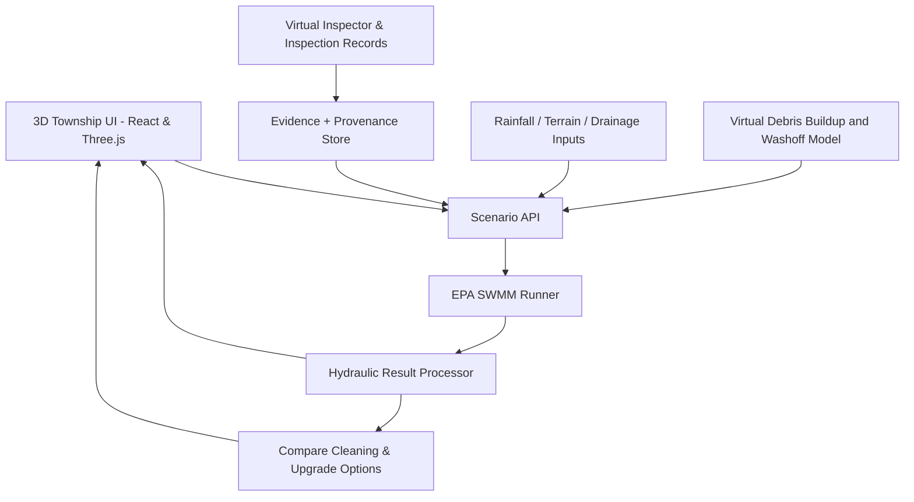

# Township FloodOps

> **From flood hindsight to flood readiness.**  
> An inspection-informed, physics-based drainage resilience platform for flood-prone townships.

## 1. The idea — in one paragraph

**Township FloodOps** helps township operators investigate *why a neighbourhood flooded*, explore *where it could flood under the next storm*, and test *which intervention is worth taking first*. In a 3D neighbourhood model, users replay rainfall scenarios, send a virtual inspector to examine a drain, explore how leaves and litter may accumulate and wash toward inlets over time, and compare cleaning against infrastructure upgrades. A hydraulic engine (EPA SWMM) produces the drainage results; the 3D interface makes the evidence, assumptions and decisions understandable.

**Pilot case study:** **Taman Kyra, Bandar Bukit Raja, Klang**, within a Sime Darby Property township. Public reporting from November 2024 documents neighbourhood flood concerns and calls from Taman Kyra residents for drainage-system review. **The case study is real; the prototype pipe network, inspection readings and debris history are not claimed to be actual Taman Kyra data.**

## 2. Problem statement

Flood resilience is not only a question of whether pipes were designed with enough capacity. The conditions of drains can change after construction: leaves, litter and sediment can obstruct inlets, while downstream water levels and drainage-network constraints influence whether water can escape.

Existing hydraulic modelling tools, including **EPA SWMM**, can evaluate runoff and drainage performance. The opportunity is **not** to replace them. It is to connect **field observations, changing drain conditions, historical event analysis and pre-storm maintenance decisions** in one accessible workflow for township operators.

**Core question:** *What should a township operator inspect or fix before the next major rainfall event—and what evidence supports that decision?*

## 3. Target users and value

- **Primary:** Township maintenance and operations teams — prioritise inspections, cleaning and escalation.
- **Secondary:** Drainage/civil engineers — review hydraulic assumptions and assess candidate interventions.
- **Stakeholders:** Property developers and residents — benefit from more transparent, evidence-based flood preparedness.

**Business value hypothesis (to validate):** Less time moving between disconnected inspection records and modelling results; better prioritisation of cleaning work; more defensible escalation of capital expenditure when cleaning alone is inadequate.

## 4. The three core product experiences

### A. Diagnose — *Why did it flood?*

1. Select a historical storm or a reconstructed **scenario**.
2. Display the affected part of the neighbourhood, subcatchments, inlets, pipes, downstream outlet and flood-prone low points.
3. Replay simulated rainfall, pipe flow, inlet restriction and node flooding.
4. Compare plausible causes: inlet clogging, insufficient network capacity, high downstream river levels, or combined effects.
5. Show the underlying evidence and flag unresolved uncertainty; **do not claim that simulation has proven the historical cause**.

### B. Anticipate — *What might happen in the next storm?*

1. Set rainfall intensity **and duration** or select a rainfall hyetograph.
2. Apply the most recent inspection observations, plus plausible clogging and downstream-boundary scenarios.
3. Run EPA SWMM to calculate runoff, conduit flows, node surcharge and flood volumes.
4. Colour the 3D network by a **clearly named metric** (e.g., pipe flow-to-capacity ratio); mark **inlet obstruction separately** from pipe overload.
5. Present a range of scenario outcomes, not a falsely precise neighbourhood-wide flood prediction.

### C. Act — *What should we do first?*

1. Compare **clean the inlet**, **upsize a pipe**, and **add detention/storage** (only where hydraulically meaningful).
2. Rerun the same storm and boundary conditions for each option.
3. Compare simulated flood volume, flood duration/affected nodes and indicative intervention burden.
4. Produce a maintenance priority or an **engineering-review recommendation**; do not label a conceptual upgrade as construction-ready.

## 5. Differentiating interaction: Virtual Field Inspection + Evidence Replay

The user clicks an inspector avatar in the 3D map. The avatar walks to an inlet/manhole, demonstrates a realistic inspection workflow, and uploads a structured record.

**Important distinction:** An electromagnetic pipe locator or sonde helps locate a buried line/probe; it does **not** directly measure leaves or plastic blocking a concrete/PVC pipe. Visible inlet debris can be assessed with a photo; internal obstructions require CCTV or other suitable inspection methods. Water-level and flow sensors provide complementary hydraulic observations.

Each inspection record should contain:

| Field | Example / role |
|---|---|
| Inlet ID + timestamp | Connect observation to location and time |
| Photo/video | Raw supporting evidence |
| Debris category | Leaves / plastic litter / sediment |
| Grate coverage | Image-based estimate, **not automatically hydraulic loss** |
| Inspection method | Visual / CCTV / sensor / simulated |
| Inspector + confidence | Provenance and quality |
| Last cleaning | Context for accumulation |
| Hydraulic model parameter | Explicitly labelled estimated/assumed/calibrated |

**Evidence Replay:** Select a drain, scrub through inspection dates, view photos, see observed changes and examine how an estimated clogging parameter alters the *modelled* flood outcome.

## 6. Virtual Drainage Lab — without a physical model

The lab is a **virtual experiment**, embedded as a close-up view of a selected stormwater inlet.

**User controls:** rainfall intensity and duration, time since last cleaning, leaf/litter loading, inlet geometry, debris capture assumptions and downstream conditions.

**The experience:**

- Time-lapse surface debris accumulation between cleaning events.
- Rainfall washes a portion of debris toward inlet locations.
- A capture model estimates how much debris stays at the inlet.
- A calibrated **or explicitly assumed** relationship maps retained debris to reduced inlet capture efficiency.
- SWMM runs the associated drainage scenario; its results determine flooding and network status.
- A 3D animation illustrates debris movement; **animation is not itself proof of physically accurate leaf-by-leaf transport**.

### Scientific boundary

A virtual experiment produces **synthetic/modelled data**, not real-world observations. It cannot be presented as evidence of Taman Kyra's actual litter loading, clogging frequency or measured drain efficiency. The team should visibly label datasets **Observed**, **Literature-derived**, **Assumed**, or **Simulated**. If no local measurements are available, show sensitivity ranges rather than assert a local blockage probability.

## 7. Engineering foundation

### 7.1 Rational Method — preliminary peak runoff check

\[
Q_p = 0.00278\, C I A
\]

- \(Q_p\): peak runoff, m³/s
- \(C\): runoff coefficient (dimensionless)
- \(I\): design rainfall intensity, mm/h
- \(A\): catchment area, ha

Use local intensity–duration–frequency (IDF) guidance and time of concentration where applicable. **This is a design peak check for suitable catchments, not a time-varying flood prediction engine.**

### 7.2 Manning equation — preliminary conduit capacity

\[
Q = \frac{1}{n}A_f R_h^{2/3}S^{1/2}
\]

- \(n\): Manning roughness
- \(A_f\): flow cross-section
- \(R_h\): hydraulic radius
- \(S\): hydraulic slope under the relevant assumptions

This is a useful sanity check, **not a replacement for dynamic network hydraulics**, particularly with backwater or surcharge.

### 7.3 Debris mass balance — accumulation and wash-off

\[
\frac{dM_s}{dt}=L(t)-W(t)-R(t)
\]

\[
\frac{dM_b}{dt}=f_{capture}W(t)-R_b(t)
\]

- \(M_s\): surface debris mass; \(L\): input/accumulation; \(W\): rain wash-off; \(R\): street cleaning/removal.
- \(M_b\): retained debris near an inlet; \(f_{capture}\): capture fraction; \(R_b\): removal/dislodgement.

Then \(B=g(M_b,\text{debris type},\text{grate geometry},\text{flow})\) estimates **hydraulic loss**. The function \(g\) requires independent research or calibration. It is **not** determined by mass balance alone.

### 7.4 Inlet restriction + EPA SWMM

For an explicitly simplified inlet-capacity sensitivity test:

\[
Q_{inlet,eff}=(1-B)Q_{inlet,clean}
\]

Here \(B\) represents **effective capture-capacity loss** for the specified hydraulic conditions, not percentage of grid area covered by leaves. Use EPA SWMM for rainfall–runoff routing, hydraulic network conditions and flooding outputs. Dynamic simulations must include storm duration and relevant downstream boundary assumptions.

**Key physical insight:** A blocked inlet may cause *more surface ponding and less flow in its downstream pipe*. Therefore, **inlet blockage colours must not be conflated with pipe capacity colours**.

### 7.5 Maximum tolerable rainfall is conditional

For a simple one-catchment conceptual check:

\[
I_{crit} \approx \frac{Q_{capacity}}{0.00278CA}
\]

For the actual demo, define a **specific rainfall duration, downstream condition, clogging assumption and acceptable flooding threshold**, then sweep rainfall scenarios in SWMM. Do not present a single mm/h value as a permanent floodproof rating for Taman Kyra.

## 8. Proposed architecture

**Suggested stack:** React + Three.js/React Three Fiber; Python/FastAPI for scenarios; EPA SWMM via a suitable wrapper/executable; structured JSON/SQLite or PostgreSQL for scenario and inspection data. Visual effects may use simple particles; a rigid-body physics library is optional and **not** a substitute for hydraulic or debris validation.

## 9. Hackathon scope — deliberately small

- **Geography:** One **illustrative residential drainage zone** inspired by the Taman Kyra case, not an asserted map of its underground assets.
- **Model:** ~8–12 junctions/inlets with connected pipes, a downstream outlet and one plausible storage option.
- **Inspection:** One virtual worker, one featured drain and a labelled synthetic inspection timeline.
- **Lab:** Leaf + plastic litter inputs, time-lapse debris model, and a clearly marked assumed/calibrated clogging sensitivity parameter.
- **Hydraulics:** Three SWMM scenarios: baseline, restricted inlet, cleaned/modified network.
- **Results:** Pipe load, inlet condition, node flooding, before/after comparison and evidence provenance.

**Out of scope for MVP:** full Taman Kyra underground drainage reconstruction; accurately predicting individual leaves; building a new CFD engine; claiming verified real-time street-level forecasts; automatic construction-ready pipe placement.

---

# 10. Three-minute pitch story

## Title: **“The drain looked fine on the blueprint.”**

### Scene 1 — The human problem (0:00–0:30)

**On screen:** News headline about flooding in Bandar Bukit Raja, then zoom to a clearly labelled *illustrative Taman Kyra neighbourhood model*.

**Speaker:**

> “In November 2024, flooding raised serious concerns in Bandar Bukit Raja. Residents of Taman Kyra called for a review of the drainage system. But for a township operator, one difficult question remains: **what actually needs attention before the next storm?**”

**Narrative purpose:** Establish a documented, locally relevant case without asserting that debris was proven to cause the reported floods.

### Scene 2 — Hidden conditions change (0:30–1:00)

**On screen:** Zoom into the 3D drain. Use the **Evidence Replay** time scrubber: newly cleaned inlet → illustrative leaf/litter accumulation → inspection flag. A virtual worker arrives and records a visual inspection, with source tags on each input.

**Speaker:**

> “A drainage system does not stay in the same condition as its design drawings. Leaves, litter and sediment can affect inlets over time. FloodOps turns inspection findings into trackable model inputs—without pretending a photo alone proves how much flow capacity was lost.”

**WOW moment 1:** The 3D drain's evidence panel updates after the inspector uploads a result.

### Scene 3 — Rainfall reveals vulnerability (1:00–1:40)

**On screen:** Open Virtual Drainage Lab. Move a rainfall slider; time-lapse debris wash-off toward the inlet. Return to township view. Run the **same storm** under clean vs restricted-inlet scenarios. Surface ponding and inlet warnings appear; pipe flow uses a separate colour legend.

**Speaker:**

> “Our virtual lab explores how rainfall can move debris toward an inlet. We then pass a clearly labelled clogging assumption into **EPA SWMM**, a proven hydraulic simulation engine, to see how the drainage network responds. **This is physics-based scenario analysis—not a fabricated flood forecast.**”

**WOW moment 2:** Split-screen clean versus clogged scenario, with modelled flooding outcomes.

### Scene 4 — From diagnosis to action (1:40–2:30)

**On screen:** A hotspot is selected. Click **Clean Inlet**, then **Upsize Pipe**, and rerun the identical storm/boundary conditions. Show comparative metrics: node flood volume, duration, intervention scope and data confidence.

**Speaker:**

> “Finding a vulnerable point is only the beginning. FloodOps asks a more practical question: **should we clean, inspect further, or invest in a drainage upgrade?** Every option is rerun through the hydraulic model, so the recommendation is based on comparable scenarios—not an AI guess.”

**WOW moment 3:** Risk comparison changes visibly when an intervention is selected.

### Scene 5 — The value (2:30–3:00)

**On screen:** An evidence-backed maintenance task appears with associated inspection, scenario assumptions and before/after hydraulic results.

**Speaker:**

> “We are not building another SWMM. We are building the missing bridge between **what teams see in the field**, **what engineers can simulate**, and **what township operators decide to do**. Starting with a documented flood-prone neighbourhood, Township FloodOps makes flood preparedness more visible, explainable and actionable.”

**Closing tagline:** **“Inspect what changes. Simulate what matters. Act before the storm.”**

---

## 11. What makes this idea distinct?

1. **Inspection-to-simulation workflow:** Records of changing drain conditions can update model assumptions rather than remain isolated in reports.
2. **Time-aware virtual debris lab:** Explore leaf/litter accumulation, wash-off and inlet restriction as transparent scenario assumptions rather than a decorative animation.
3. **Diagnosis + anticipation + action:** Historical scenario analysis and future storm testing share a common model and produce maintenance choices.
4. **Evidence provenance:** Every data point is labelled *observed, literature-based, assumed, or simulated*.
5. **Operational decision support:** Compare routine cleaning with capital upgrades before recommending expenditure.

**Competition caveat:** Commercial flood and asset-management platforms already offer parts of these capabilities. The differentiation is a proposed **township-focused, inspection-led integrated workflow**, not a claim that no existing software has 3D modelling, inspections or optimization.

## 12. Judging objections and answers

**Q: Why not just use EPA SWMM?**  
A: We do use it for hydraulic computation. FloodOps adds an accessible inspection-to-model workflow, a time-aware debris scenario layer, evidence replay, and maintenance-oriented comparisons. Whether this workflow beats existing commercial options requires user validation.

**Q: Is the debris simulation real physics?**  
A: The hydraulic consequences are modelled using SWMM. Debris buildup and wash-off follow mass-balance and parameterised capture assumptions; 3D individual leaf movement is illustrative unless separately validated. We never represent synthetic data as field measurements.

**Q: Do you have the actual Taman Kyra drainage drawings?**  
A: Not yet. We use a deliberately simplified, labelled illustrative zone while grounding the problem in public reports. The next step would be obtaining approved drainage asset records and calibrating to observed rainfall, water levels and flooding.

**Q: Can it predict the next flood accurately?**  
A: The MVP compares plausible storm scenarios and relative risks. Reliable location-specific forecasting requires verified topography, network details, downstream boundary conditions, recent inspections and independent validation.

**Q: Why make it 3D?**  
A: 3D connects street-level observations, buried pipe connections and surface ponding so non-specialist operations teams can understand *where* an issue was observed and *how* it affects the system. Quantitative results remain sourced from the calculation engine.

## 13. Validation checklist before the final pitch

- [ ] Attach original news links/screenshots confirming the Taman Kyra / Bandar Bukit Raja case and carefully state exactly what they report.
- [ ] Check the applicable Malaysian **MSMA** drainage-design guidance, especially rainfall IDF and Rational Method applicability.
- [ ] Confirm the specific SWMM version and inlet-clogging implementation used.
- [ ] Record every assumed pipe diameter, slope, roughness, inlet geometry, land-use area and downstream condition.
- [ ] Run clean, blocked and mitigated scenarios with identical rainfall/boundary inputs.
- [ ] Verify that displayed 3D warnings are derived from the same simulation output, not from fixed animation triggers.
- [ ] Distinguish synthetic inspection history from genuine field records in the UI and pitch.
- [ ] Avoid giving an uncalibrated “real blockage probability” or a universal “maximum safe rainfall” for Taman Kyra.

## 14. Background references to validate and cite in your final deck

- **EPA SWMM:** https://www.epa.gov/water-research/storm-water-management-model-swmm
- **Malaysia MSMA (Urban Stormwater Management Manual):** https://wplb.water.gov.my/assets/msma-2nd-edition.pdf
- **Malaysian flood/rainfall observations:** https://publicinfobanjir.water.gov.my/
- **Malaysia public data APIs:** https://developer.data.gov.my/
- **Case study:** Locate and attach the original November 2024 reporting on Taman Kyra residents' call for drainage review, plus Sime Darby Property's relevant statements; verify publication titles and wording before the public pitch.

---

**One-line positioning:** *Township FloodOps is an inspection-informed 3D drainage decision-support platform that uses established hydraulic simulation to turn changing drain conditions into actionable flood preparedness.*
