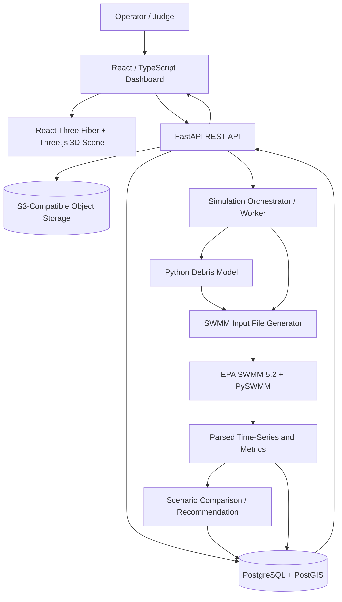

# Township FloodOps — System Architecture & Detailed Tech Stack

> **Product:** Inspection-informed flood diagnosis, scenario-based risk simulation and intervention comparison for a flood-prone residential neighbourhood.  
> **Case-study framing:** Taman Kyra, Bandar Bukit Raja (Sime Darby Property township). The case study is motivated by publicly reported flooding and drainage concerns; **the proposed 3D streets, pipe layout, inspection histories and parameters are illustrative unless independently sourced and verified**.  
> **Architecture status:** Proposed hackathon MVP, not a certified flood-risk model.


## 1. System design principles

1. **Don't rebuild SWMM.** Run EPA SWMM as the hydraulic source of truth and use its results in 3D.
2. **Separate observations from simulation.** Observed (timestamped inspection/media), estimated (image-derived grate coverage), assumed (sample asset parameters), and simulated (hydraulic/debris model outputs) must be clearly labelled.
3. **Model inlet obstruction separately from pipe loading.** A blocked inlet can increase surface ponding while downstream pipes are underutilised.
4. **One dataset, two modes.** Historical diagnosis and prospective rainfall scenarios both reuse the same catchments, conduits, nodes and outfall conditions.
5. **Surface flood extents are conditional.** SWMM node ponding/flooding outputs do not automatically constitute a validated 2D flood-inundation map. Accurate street-depth maps require terrain and coupled surface-flow modelling.
6. **Make inspection traceable.** Inspection images, model versions, input assumptions, experiment outputs and maintenance actions must be auditable.

## 2. High-level architecture



**IMPORTANT:** Virtual debris animations are visualizations of model states, **not** independent proof that every leaf follows a computational-fluid-dynamics (CFD) trajectory.

## 3. Technology stack by layer

| Layer | Recommended technology | Role | MVP status | Decision rationale |
|---|---|---|---|---|
| Web framework | **React + TypeScript + Vite** | UI state, views, form controls, playback | P0 | Efficient browser demo; type-safe data contracts |
| 3D rendering | **Three.js + React Three Fiber + Drei** | Buildings, roads, underground pipes, inspector, colour overlays | P0 | Browser-native; integrates with React |
| Charts | **Recharts** | Hydrographs, clogging history, before/after KPIs | P0 | Simple interactive charts |
| UI system | **Tailwind CSS + shadcn/ui** | Scenario slider, inspection cards, controls | P1 | Rapid styling and consistent components |
| Backend API | **Python + FastAPI + Pydantic** | CRUD, validation, job submission, results | P0 | Strong Python simulation ecosystem |
| Hydraulic engine | **EPA SWMM 5.2** | Runoff routing, pipes, junctions, backwater, surcharge, flooding | P0 | Established hydrologic/hydraulic engine |
| SWMM integration | **PySWMM**, plus SWMM `.inp` / `.out` tools as appropriate | Programmatic execution, report/output extraction | P0 | Leverages SWMM rather than approximating its physics |
| Debris buildup/washoff | **Python + NumPy/Pandas** | Hypothetical debris time histories and inlet loading | P1 | Easy to inspect, test and sensitivity-analyse |
| CV (optional) | **OpenCV; segmentation model only with evaluated labels** | Image-based *visible grate coverage*, not underground blockage | P2 | Only valuable with real images/inspection observations |
| Scenario evaluation | **Python + Pandas/NumPy** | Baseline vs cleaning / upsize / detention simulation | P1 | Explainable parameter sweeps rather than black-box AI |
| Relational / geospatial DB | **PostgreSQL + PostGIS** | Inlet coordinates, inspection records, scenarios, metadata | P1 | Strong spatial support; SQLite for single-machine MVP is viable |
| File storage | **S3-compatible** (e.g. Cloudflare R2 or AWS S3) | Uploaded photos, videos, model assets, input/output files | P2 | Keeps binary files out of SQL |
| Background tasks | **Redis + RQ** or Celery | Longer simulations, progress/status | P2 | Avoid timeouts; simple synchronous jobs adequate at small scale |
| Packaging | **Docker + Docker Compose** | Reproducible backend/SWMM environment | P0 | Pin SWMM version and dependencies |
| Frontend hosting | **Vercel / Cloudflare Pages** | Static SPA hosting | P1 | Quick deployment |
| API/worker hosting | **Container-capable platform / VM** | Run native SWMM binary and Python | P1 | Do not assume SWMM works on edge/serverless runtimes |
| CI | **GitHub Actions** | Lint, tests, build and deploy | P2 | Reliability under team development |

### Why not build an additional full particle physics engine?

A game physics library such as Rapier can animate collisions, but alone cannot reproduce sediment transport, fluid turbulence or validated trash capture at a grate. For the MVP, use a **mass-balance / empirical debris model** and clearly labelled 3D visualization. CFD or fluid–structure coupling is future work only if validated experimental geometry and data become available.

## 4. Subsystem responsibilities

### 4.1 3D Township Viewer

**Input:** Geospatial/stylized geometry, drainage topology, time-indexed SWMM outputs, inspection evidence.  
**Output:** Pipe colours, clicked assets, inspection popovers, model playback and animated rainfall.

- Scene: limited residential block, roads, drains, selected inlets, a downstream outfall and a simplified nearby watercourse boundary.
- Load actual geospatial data only where legally available; otherwise tag the dataset `synthetic_demo`.
- Pipes: mesh tubes keyed to `conduit_id`; junctions/inlets keyed to `node_id` / `inlet_id`.
- Toggle layers: surface, underground drains, inspections, modelled surcharge, rainfall/debris animations.
- Colour **conduit capacity/load** based on SWMM-derived metrics; show **inlet blockage** with separate symbols/hatching.
- Timeline playback: precomputed frames, e.g. 1–5 min intervals of a simulated storm, with interpolation for animation only.
- 3D inspector: scripted movement to the asset. Uploading photos or selecting mock CCTV results creates a versioned *inspection record*; it is not evidence that a real inspection occurred.

### 4.2 Field Inspection and CV

**Recommended operator sequence:** select drain → inspect → upload photo/video → identify debris class → estimate visible grate coverage → accept/correct → save with provenance.

Measured or recorded fields:
- `asset_id`, `captured_at`, `inspector_id`, `coordinates`, `inspection_method`, `media_url`, `evidence_source`.
- Observations such as leaves present, litter present, sediment present, visible structural damage.
- Optional CV returns `visible_grate_coverage_pct`, model identifier and confidence/quality score.

**Do not silently convert** 30% photo coverage into 30% hydraulic capture loss. A distinct, documented and calibrated transformation must be introduced if available.

### 4.3 Debris time-series model

A first-order **conceptual** mass balance:

\[
\frac{dM_s}{dt}=L(t)-W(t)-R_s(t)
\]
\[
\frac{dM_b}{dt}=f_{\mathrm{capture}}(t)W(t)-R_b(t)
\]

where `M_s` is accumulated surface debris, `L` deposition/littering, `W` washoff, `R_s` surface removal, `M_b` debris retained at an inlet, and `R_b` inlet cleaning/release (consistent mass/time units).

To connect physical debris accumulation with SWMM inlet capture loss:

\[
B(t)=g(M_b,\text{debris mix, grate geometry, flow conditions})
\]

`g` is an **empirical uncertain relationship**, *not* a universally established equation for Taman Kyra. Use explicit scenario assumptions/ranges, not fabricated ground-truth clogging probabilities.

Model alternatives:
- **MVP**: operator selects 0/20/40/60% `percent_clogged` scenarios; the debris timeline justifies a *scenario*, not an inferred fact.
- **Intermediate**: calibrated literature parameter scenarios; run Monte Carlo with documented priors and sensitivity analysis.
- **Production**: local longitudinal inspection + hydraulic measurements to fit and independently validate `g`.

### 4.4 Hydraulic model

EPA SWMM 5.2 runs rainfall-runoff and hydraulic routing (prefer dynamic wave if accounting for surcharge/backwater). Represent:
- subcatchments, impervious fractions, widths/slopes, infiltration assumptions;
- junctions/manholes, conduits/culverts, inlets, outfalls;
- rainfall hyetographs, routing step, downstream head/tailwater;
- inlet capture/clogging configuration if modelled with a supported SWMM input format.

Basic cross-check calculations:

**Rational Method**, when applicable to small design catchments:

\[
Q_p=0.00278\,C\,I\,A
\]

`Qp` in m³/s, `I` in mm/h, `A` in ha, `C` dimensionless. Rainfall intensity should derive from selected IDF/ARI and duration/time of concentration, consistent with Malaysian MSMA guidance.

**Manning uniform-flow capacity check:**

\[
Q=\frac1n A_f R_h^{2/3} S^{1/2}
\]

This is a **screening/design check**; it is not a replacement for SWMM hydraulic-grade-line analysis, especially in backwater/pressurized states.

**Storage mass balance:**

\[
\frac{dV}{dt}=Q_{\rm in}-Q_{\rm out}
\]

**Flood threshold:** search storm scenarios and report the **largest tested intensity that meets an explicit failure criterion**, e.g. `node_flooding_volume < threshold`, specifying storm duration, pattern, return period, pipe state, outfall boundary and confidence. Avoid claiming an unconditional 'maximum rainfall the township can take'.

### 4.5 Diagnosis + prospective scenarios

**Diagnosis:** load a historical storm and site evidence → reproduce what is observable → vary plausible causes (blocked inlet, pipe capacity, high tailwater) → report which hypotheses are consistent with observations and which require more data. This is **not causal proof** without adequate observations/calibration.

**Prediction:** load a forecast or synthetic rainfall hyetograph and the latest available model state → simulate possible node surcharge/ponding under specified scenarios. Unless validated with independent events, label results **scenario-based risk assessment**, not precise street-level forecasts.

### 4.6 Intervention recommendation

For each candidate action, clone baseline model and rerun:

1. `clean_inlet`: reduce assumed inlet clogging to a post-cleaning value.
2. `upsize_conduit`: change one conduit diameter and verify impacts upstream/downstream.
3. `add_storage`: add an illustrative detention/storage element with controlled outlet.
4. `outfall_constraint`: test downstream river-water level; may reveal interventions are ineffective without downstream action.

Compare: peak flooding volume (m³), total node flooding (m³), duration of surcharge (min), maximum depth where supported, number of affected nodes and *rough order-of-magnitude* cost. Rank candidates only after specifying objectives and assumptions. Any actual engineering design requires qualified review.

## 5. End-to-end data flow

1. **Create base model:** source asset geometry or synthetic example → `model_version` stored.
2. **Capture observation:** operator records a photo/CCTV event → metadata + immutable media reference.
3. **Estimate visible blockage:** optional CV produces coverage and uncertainty; operator can correct it.
4. **Select debris hypothesis:** choose explicit clogging scenario or calibrated mapping; store provenance.
5. **Build scenario:** combine model version + hyetograph + tailwater + inlet assumptions + intervention ID.
6. **Run SWMM:** worker builds/validates `.inp`, executes SWMM, stores logs and `.out` files.
7. **Parse metrics:** retain per-node/per-conduit time series; calculate KPIs and failure criteria.
8. **Render result:** dashboard fetches frame series and shows colour overlays, flooding indicators and the evidence chain.
9. **Compare:** rerun counterfactual scenarios and show outcomes; never alter a previous run in place.

## 6. Data contracts and schema

### Suggested PostgreSQL tables

| Table | Essential fields | Description |
|---|---|---|
| `assets` | `id`, `asset_type`, `geom`, `name`, `source_type`, `source_ref` | Inlets, manholes, conduits, outfalls |
| `model_versions` | `id`, `swmm_inp_uri`, `source_type`, `created_at`, `assumptions_json` | Immutable model base |
| `inspections` | `id`, `asset_id`, `captured_at`, `method`, `inspector`, `is_simulated`, `media_uri` | Data provenance |
| `cv_observations` | `inspection_id`, `coverage_pct`, `model_version`, `quality_flag` | Visible coverage, NOT flow loss |
| `debris_scenarios` | `id`, `params_json`, `source_type`, `calibration_status`, `seed` | Debris hypotheses |
| `storms` | `id`, `name`, `hyetograph_json`, `return_period`, `rain_source` | Time-varying precipitation |
| `runs` | `id`, `model_version_id`, `storm_id`, `debris_scenario_id`, `status`, `input_hash`, `out_uri` | Reproducible execution |
| `run_metrics` | `run_id`, `asset_id`, `time`, `flow`, `depth`, `flooding_rate`, `surcharge_flag` | Time-series outputs |
| `interventions` | `id`, `base_run_id`, `type`, `target_asset_id`, `changes_json`, `cost_assumption` | Candidate fix |
| `audit_events` | `id`, `actor`, `action`, `entity_id`, `created_at` | Change tracking |

### Example API endpoints

| Method | Endpoint | Main purpose |
|---|---|---|
| `GET` | `/api/townships/{id}/assets` | Geometry, identifiers and provenance |
| `POST` | `/api/inspections` | Save site or virtual inspection metadata |
| `POST` | `/api/inspections/{id}/media` | Upload inspection evidence |
| `POST` | `/api/inspections/{id}/analyze` | Optional CV-derived coverage |
| `POST` | `/api/debris/scenarios` | Create debris hypothesis |
| `POST` | `/api/simulations` | Start immutable SWMM scenario run |
| `GET` | `/api/simulations/{id}` | State/progress, input summary |
| `GET` | `/api/simulations/{id}/frames` | Timestamped node/pipe results |
| `GET` | `/api/simulations/{id}/metrics` | Aggregated flood metrics |
| `POST` | `/api/interventions/compare` | Trigger reruns and compare candidates |

Example request:

```json
{
  "model_version_id": "taman_kyra_synthetic_v1",
  "storm_id": "synthetic_80mmh_60min",
  "debris_scenario_id": "demo_inlet_40pct",
  "tailwater_case": "normal",
  "intervention": null
}
```

Example response:

```json
{
  "run_id": "run_001",
  "status": "queued",
  "is_verified_site_model": false,
  "data_labels": ["assumed", "simulated"]
}
```

## 7. Local development and deployment

```text
township-floodops/
├── apps/
│   └── web/                   # React + TS + React Three Fiber
├── services/
│   └── api/                   # FastAPI endpoints, Pydantic schemas
├── simulation/
│   ├── swmm/                  # Example .inp and output parsing
│   ├── debris/                # Buildup/washoff + scenario hypotheses
│   ├── scenarios/             # Base + intervention scenario templates
│   └── tests/                 # Conservation / regression tests
├── data/
│   ├── synthetic/             # Clearly labelled sample township
│   └── references/            # Source metadata, NOT invented surveys
├── infra/
│   ├── docker-compose.yml
│   └── Dockerfile.api
├── docs/
│   └── architecture.md
└── README.md
```

**Local:** React dev server + FastAPI + Dockerized SWMM-enabled worker + DB.  
**Deployed:** static frontend hosting; container server for FastAPI, SWMM binary and worker; managed PostgreSQL / object storage if needed. Pin image tag and SWMM version; preserve logs and input hash for reproducibility.

Practical constraints:
- SWMM computation runs **server-side**, not in React/Vercel edge functions.
- Native packages and SWMM/PySWMM version compatibility must be tested in the actual Docker image.
- Budget for API job timeouts and concurrent runs; a Redis queue can be introduced when needed.
- For a fully standalone hackathon demo, local Docker Compose plus a hosted frontend is sufficient, provided the demonstration backend remains online.

## 8. MVP work breakdown and acceptance criteria

| Phase | Deliverable | What must work in the demo |
|---|---|---|
| **P0 — Model integrity** | Tiny synthetic SWMM network and reproducible 2–3 storm scenarios | Results from actual SWMM execution, not hard-coded pipe colors |
| **P1 — 3D scene** | Residential block with connected assets and timeline | Click asset, play calculated time series, see risk distinction |
| **P1 — Inspection** | Virtual inspector + inspection upload/history | Record stored with simulated/observed provenance |
| **P1 — Debris link** | At least 3 labelled clogging scenarios | Scenario changes inlet capture and SWMM results, with units and limits |
| **P1 — Intervention** | Clean inlet vs pipe upsize vs baseline | Runs compared on identical rainfall and tailwater |
| **P2 — CV** | Real uploaded image segmentation demo | CV returns *visual coverage* only; optional if no field photos |
| **P2 — Uncertainty** | Batch scenario sensitivity plot | Parameter ranges and number of runs shown, no false confidence |
| **P3 — Field calibration** | Verified asset inventory + independent flood observations | Required for real-world predictive claims, outside MVP |

### Essential technical tests

- **Physical plausibility:** increasing rainfall should generally increase runoff for fixed conditions (with documented exceptions/limits).
- **Mass consistency:** debris model conserves tracked mass across deposition, wash-off, capture and removal (within numerical tolerance).
- **SWMM QA:** monitor continuity errors and fail/warn on unacceptable numerical behaviour.
- **Reproducibility:** same input model, meteorology, seed and SWMM version produce consistent result files.
- **Counterfactual validity:** baseline and interventions use identical storm and outfall boundary inputs.
- **Data provenance:** synthetic readings never appear as observed Taman Kyra measurements.

## 9. How to present the architecture to judges

**A clear 20-second explanation:**

> “Our web-based 3D township interface is built with React and Three.js. Inspection records and debris scenarios flow through a FastAPI backend. We use an actual EPA SWMM engine for drainage hydraulics and a separate transparent Python debris model for accumulation and inlet-clogging assumptions. We then show the results and compare maintenance interventions in the same map. Every result is labelled as observed, estimated, assumed, or simulated.”

**Distinctive value:** Not another hydraulic engine, but a **field-to-model-to-action workflow** focused on township operations and maintenance.

## 10. References and engineering boundaries

- **EPA SWMM:** https://www.epa.gov/water-research/storm-water-management-model-swmm
- **EPA SWMM reference manuals/user manual:** linked from the EPA SWMM page.
- **PySWMM:** https://www.pyswmm.org/
- **Malaysia MSMA guidance:** consult JPS/Department of Irrigation and Drainage authoritative manuals and local IDF data.
- **Field data gap:** without actual Taman Kyra asset drawings, street-level flood depths, pipe dimensions, inspection records and calibration events, do **not** advertise this as a validated model or use it to direct physical construction.

---

**Scope recommendation:** One synthetic residential block inspired by a documented flood-prone township; 8–12 junctions, 8–15 conduits, 3–5 inlets, one outfall, one scripted inspector, one photo evidence workflow, three rainfall scenarios, three clogging scenarios and two alternative interventions. Build the hydraulic loop first, then the 3D visualization.
